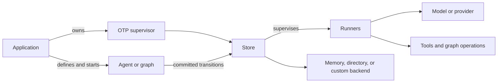

# Fabric

[](https://github.com/gleam-dream/fabric/actions/workflows/ci.yml)
[](https://hex.pm/packages/fabric)
[](https://gleam.run/)

Fabric runs bounded LLM agents and durable control graphs in Gleam on Erlang/OTP.
Typed tools and application policy govern effects; recorded outcomes support
approval and recovery. Applications provide models, domain operations,
authorization and resource supervision.

Use Fabric when an agent or workflow needs typed boundaries, approval, or recovery across process loss. Fabric targets Erlang and requires Gleam 1.18 or later.

## Capabilities

- Build checked agents with typed tools, typed final answers, and explicit limits.
- Bound model attempts, concurrent tool bodies, timeouts, and optional token or family budgets.
- Gate actions with application policy; support approval, rejection, cancellation, and effect reconciliation.
- Retain run records and inspect, reopen, or recover work through a supervised store.
- Build conditional graphs with typed state and durable routes, signals, jobs, managed children, and structured forks.
- Use a model callback or the `llm_wire` adapter, with provider generation settings.
- Serve agents or graphs through protocol-neutral, optionally keyed invocation.

## Typical uses

- Approval-gated external actions such as payments, where an uncertain request must wait for review or reconciliation. See the [tested payment desk](test/fabric/readme_example.gleam) and its [test](test/fabric/readme_test.gleam).
- Multi-stage workflows that route on typed results, wait for human signals, or observe external jobs. See the [graph consumer](consumers/graph/README.md) and [job consumer](consumers/jobs/README.md).
- Request or job handlers that need to reopen a run by a stable id after a retry or restart. See the [usage examples](examples/usage/README.md).

Fabric does not provide retrieval or vector storage, agent token streaming, remote agent protocols, distributed Erlang, or general workflow compensation. Saga, Relay, and Hellhound integrations are application recipes; see the [module documentation](src/fabric/tool.gleam) and [consumer examples](consumers/).

## Install

Add Fabric from Hex:

```sh
gleam add fabric
```

Commit `gleam.toml` and `manifest.toml` to retain the resolved versions.
The examples below use `agent.build_with`, from Fabric 0.5.0. On 0.4.0,
build the agent with `agent.build` and do not send it to other processes
per operation.
The optional [PostgreSQL adapter](integrations/fabric_postgres/README.md)
installs from a Git subdirectory; its release `fabric_postgres-v0.4.0`
requires fabric `>= 0.5.0 and < 0.6.0`.

## Start with an agent

This short-lived summarizer uses an in-memory store. Pass a model made with `fabric/llm.model(client, config, model_id)` and the application's started HTTP Gun client, or provide a custom `fabric/model.Model`.

<!-- prettier-ignore-start -->

<!-- snips: examples/usage/src/usage/summarize.gleam#summarize -->
```gleam
import fabric
import fabric/agent
import fabric/model
import fabric/policy
import fabric/run
import fabric/store
import fabric/store/backend
import gleam/erlang/process
import gleam/option.{None}
import gleam/result
import gleam/time/duration

pub type Error {
  InvalidAgent(List(agent.ConfigError))
  StoreFailed(backend.StoreError)
  RunFailed(fabric.Error)
}

pub fn summarize(
  model: model.Model,
  text: String,
) -> Result(run.Status(String), Error) {
  use summarizer <- result.try(
    agent.build_with(fn() {
      agent.new("summarizer", model, [], policy.always_allow())
      |> agent.with_system_prompt(
        "Summarize the supplied text in one paragraph.",
      )
      |> agent.with_max_turns(2)
      |> agent.with_model_timeout(run.After(duration.seconds(20)))
    })
    |> result.map_error(InvalidAgent),
  )
  let runs = store.in_memory(process.new_name("summaries"))
  use Nil <- result.try(store.start(runs) |> result.map_error(StoreFailed))
  let outcome =
    fabric.start(
      runs,
      summarizer,
      id: run.new_id(),
      context: Nil,
      prompt: text,
      correlation: None,
    )
    |> result.try(fabric.await(_, within: duration.seconds(45)))
    |> result.map_error(RunFailed)
  use Nil <- result.try(store.stop(runs) |> result.map_error(StoreFailed))
  outcome
}
```

<!-- prettier-ignore-end -->

The in-memory records disappear when the store stops. Services needing recovery supervise a persistent store and keep each run id. A completed answer does not prove every action succeeded; inspect `fabric.snapshot` before treating it as business success.

## Codecs in tools and answers

_`agent.build_with` and `fabric.AgentUnbuildable` are available from Fabric 0.5.0._

Every run executes in its own runner process, with its tool bodies and model calls in tasks of that runner, and the BEAM copies a value whole into each process it reaches. Fabric therefore never sends an agent: `agent.build_with` keeps the function that makes the agent's spec, and a process that needs the agent builds it there. The caller builds it once per `fabric.start`, `open` or `recover`, and each runner once before it writes anything. A tool's task receives only that tool, with its codecs. What a run copies is its builder, its context and its record. The deprecated `agent.build` returns a built agent, which is copied whole into every runner.

Write tool and answer codecs by the [json_blueprint codec practice](https://github.com/lostbean/json_blueprint/blob/main/docs/CODEC-PRACTICE.md) (json_blueprint 2.1.1 or later). Fabric's part of it:

- Give `agent.build_with` a builder that builds the same agent every time from small values that are the same for every run: an HTTP client, settings, ids loaded once. A builder that captures a built tool or codec brings the copy back. Another name or version is refused before anything is stored (`fabric.AgentUnbuildable`), but `open`, `recover` and the sweeper check only those, not what the builder captured.
- Make subjects, names and tables outside the builder and capture them; one made inside is made again in every process.
- Make tool and answer codecs inside the builder, by the guide's rules for child codecs and run-time enums. A run-time enum from values that differ per run makes a per-run agent: re-derive its values when you `open` or `recover`, and recover those runs yourself, since `sweeper.agent` registers one agent per name and version.
- A `fabric.Run` handle holds the built agent: send the run's id to another process and `open` it there.

<!-- prettier-ignore-start -->

<!-- snips: examples/usage/src/usage/codecs.gleam#codecs -->
```gleam
import fabric/agent.{type Agent}
import fabric/model.{type Model}
import fabric/policy
import fabric/tool
import gleam/list
import gleam/result
import json/blueprint/codec.{type Codec}

pub type Line {
  Line(memo: String, cents: Int)
}

pub type Transfer {
  Transfer(to: String, lines: List(Line))
}

/// Each child codec is made inside its field, by its own function. The
/// payee is a run-time enum: the desk's account ids, made into a codec
/// inside the field.
fn transfer_codec(accounts: List(String)) -> Codec(Transfer) {
  use to <- codec.field(
    "to",
    codec.string_enum(list.map(accounts, fn(id) { #(id, id) })),
    get: fn(transfer: Transfer) { transfer.to },
  )
  use lines <- codec.field(
    "lines",
    codec.list(of: line_codec()),
    get: fn(transfer: Transfer) { transfer.lines },
  )
  codec.success(Transfer(to:, lines:))
}

fn line_codec() -> Codec(Line) {
  use memo <- codec.field("memo", codec.string(), get: fn(line: Line) {
    line.memo
  })
  use cents <- codec.field("cents", codec.int(), get: fn(line: Line) {
    line.cents
  })
  codec.success(Line(memo:, cents:))
}

fn transfer_tool(accounts: List(String)) -> tool.Tool(Nil) {
  tool.define(
    "transfer",
    "Pay one of the desk's accounts.",
    transfer_codec(accounts),
    codec.string(),
  )
  |> tool.bind(
    fn(_context, _call, transfer: Transfer) -> Result(String, Nil) {
      Ok("paid " <> transfer.to)
    },
    fn(_) { tool.Explain("transfer failed") },
  )
}

/// The desk's agent, which may pay `accounts`: ids the application loads
/// once and gives every run, so that the agent `open`, `recover` and the
/// sweeper build is the one each run started with. The builder captures
/// the ids and the model; `transfer_tool` runs in every process that builds
/// it. Run-time labels can repeat, so the codec is checked where they
/// arrive.
pub fn payer(
  model: Model,
  accounts: List(String),
) -> Result(Agent(Nil, String), String) {
  use _ <- result.try(
    codec.check(transfer_codec(accounts))
    |> result.map_error(codec.describe_definition_error),
  )
  agent.build_with(fn() {
    agent.new("payer", model, [transfer_tool(accounts)], policy.always_allow())
  })
  |> result.map_error(agent.describe_config_errors)
}
```

<!-- prettier-ignore-end -->

## Core model

The application builds a checked `Agent` or `Graph` definition and starts runs in a `Store`. The store retains run state and supervises runners; a handle only addresses a run, not its worker. Typed `Tool` and graph `Operation` boundaries classify external results, while application `Policy` and approval verifiers decide who may proceed.



## Ownership and recovery

- The application starts and stops HTTP clients, database pools, verifiers, and store supervision. Context and credentials stay live in the application and are not stored with runs.
- Dropping a run handle does not cancel its run. `open` reads or commands a run; `recover` takes over work only when its prior runner is gone. On an unleased store, recover after the prior owner has stopped. A leased store checks ownership before takeover.
- If a tool or operation may have reached an external system without a saved result, Fabric retains it as uncertain and blocks dependent progress until it is reconciled. Declare replay only when repeating that effect is safe.
- The directory store supports process or VM restart on one host, but does not promise power-loss durability. Use an application backend for production durability; see the [PostgreSQL adapter](integrations/fabric_postgres/README.md).
- Set execution bounds before starting work. Model/tool timeouts are not a whole-run
  deadline; token and family budgets are opt-in. See [agent](src/fabric/agent.gleam)
  and [graph](src/fabric/graph.gleam) for the available limits.

## Handing a call over to another system

When a person or another system decides a call, possibly days later, the
policy hands it over with `policy.HandOver(reason)`. The run ends at once as
`run.HandedOver`, with the call's action, tool and arguments as recorded: the
tool never runs, the model takes no further turn, and no approval is left to
answer or expire. Other calls of the same model reply that had not started are
withdrawn. The application files the call keyed by its action's text form
(`run.action_ref_to_string`, read back with `run.parse_action_ref`). When the
decision is recorded, `fabric.handover_history` returns the conversation with
the decision as the call's result, and `input.continuation` starts a follow-on
run from it with no new user message, so the model continues from the decision
as it would have in the original run. Add a prompt with `input.new` only when
the application has something new to tell the model.

The follow-on run has the same agent and the same policy. A policy that always
hands the call over hands it over again if the follow-on model repeats the
call, so the policy recognises the follow-on, here from its context, and denies
the repeat.

<!-- prettier-ignore-start -->

<!-- snips: examples/usage/src/usage/handover.gleam#handover -->
```gleam
/// Which run the policy decides for: the one that proposes, or the
/// follow-on that tells the customer what was decided.
pub type Stage {
  Deciding
  Telling
}

/// Refunds are decided by finance, never by the agent's run. The follow-on
/// run has the same agent and policy: there a repeated refund call is
/// denied, or it would be handed over again.
fn refund_policy(stage: Stage, action: policy.Action) {
  case action.name, stage {
    "refund_fee", Deciding ->
      Ok(policy.HandOver("refunds are decided by finance"))
    "refund_fee", Telling -> Ok(policy.Deny("the refund is already decided"))
    _, _ -> Ok(policy.Allow)
  }
}

/// Runs the agent until it rests. A handover gives the application the
/// call to file, keyed by its action's text form.
fn file_refund(
  runs: store.Store,
  desk: agent.Agent(Stage, String),
  id: run.RunId,
) -> Result(#(String, String), String) {
  let assert Ok(handle) =
    fabric.start(
      runs,
      desk,
      id:,
      context: Deciding,
      prompt: "Refund Ana's fee.",
      correlation: None,
    )
  case fabric.await(handle, within: duration.seconds(5)) {
    Ok(run.Finished(run.HandedOver(action:, arguments_json:, ..))) ->
      Ok(#(run.action_ref_to_string(action), arguments_json))
    other -> Error(string.inspect(other))
  }
}

/// Once the decision is recorded: a follow-on run continues the handed-over
/// conversation from the decision, given as the call's result.
fn tell(
  runs: store.Store,
  desk: agent.Agent(Stage, String),
  handed: run.RunId,
  decided: String,
) -> Result(fabric.Run(Stage, String), String) {
  use first <- result.try(
    fabric.open(runs, desk, Deciding, handed)
    |> result.map_error(string.inspect),
  )
  use snapshot <- result.try(
    fabric.snapshot(first) |> result.map_error(string.inspect),
  )
  use history <- result.try(
    fabric.handover_history(snapshot, result: decided)
    |> result.map_error(string.inspect),
  )
  use follow <- result.try(
    input.continuation(history) |> result.map_error(string.inspect),
  )
  fabric.start_with_input(
    runs,
    desk,
    id: run.new_id(),
    context: Telling,
    input: follow,
    correlation: None,
  )
  |> result.map_error(string.inspect)
}
```

<!-- prettier-ignore-end -->

Only a run that ended `HandedOver` has a handover history. A run parked on an
approval under the earlier approach and then ended with `fabric.cancel` cannot
be continued this way in 0.3.0: an application moving from parking to handing
over tells those in-flight cases from its own record or starts a fresh run.

A graph run takes no handover; it waits for the other system as a signal. See
[`usage/handover`](examples/usage/src/usage/handover.gleam) and
[ADR 0021](docs/adr/0021-hand-a-call-over-by-policy-and-end-the-run.md).

## Examples

The [usage examples](examples/usage/README.md) cover bounds, failure classification, waiting, budgets, reconciliation, and recovery. The [graph consumer](consumers/graph/README.md), [decision consumer](consumers/decision/README.md), [jobs consumer](consumers/jobs/README.md), and [writing consumer](consumers/writing/README.md) show larger applications. The [PostgreSQL adapter](integrations/fabric_postgres/README.md) documents database-backed leases and operations.

Generation settings are fixed on a model instance and supplied again when rebuilding a runtime. Fabric retains its own messages, tools, answer decoding, and correlation. This checked excerpt assumes imports from `fabric/agent`, `fabric/llm`, `fabric/policy`, `llm_wire/generation`, and `json/blueprint/codec`; `client` and `config` come from your provider setup.

<!-- prettier-ignore-start -->

<!-- snips: consumers/app/test/generation_settings_test.gleam#generation-settings -->
```gleam
let settings =
  generation.default()
  |> generation.with_max_tokens(128)
  |> generation.with_temperature(0.2)
let assert Ok(agent) =
  agent.build_with(fn() {
    agent.new(
      "configured",
      llm.configured_model(client, config, "fixture", settings),
      [],
      policy.always_allow(),
    )
    |> agent.with_answer(codec.int())
  })
```

<!-- prettier-ignore-end -->

The [design](docs/design/design-layer.pdf) defines supported contracts, limits, and unbuilt capabilities. [BENCHMARKS.md](docs/BENCHMARKS.md) records historical live-provider measurements and their limits; Fabric has no runtime benchmark harness. See [AGENTS.md](AGENTS.md) for development and validation commands.
