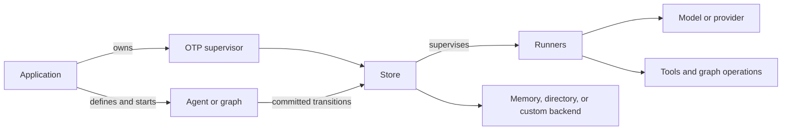

# Fabric

Fabric runs bounded LLM agents and durable control graphs in Gleam on Erlang/OTP.
Typed tools and application policy govern effects; recorded outcomes support
approval and recovery. Applications provide models, domain operations,
authorization and resource supervision.

Use Fabric when an agent or workflow needs typed boundaries, approval, or recovery across process loss. Fabric targets Erlang and requires Gleam 1.18 or later. It is not yet published to Hex.

## Capabilities

- Build checked agents with typed tools, typed final answers, and explicit limits.
- Bound model attempts, concurrent tool bodies, timeouts, and optional token or family budgets.
- Gate actions with application policy; support approval, rejection, cancellation, and effect reconciliation.
- Retain run records and inspect, reopen, or recover work through a supervised store.
- Build conditional graphs with typed state and durable routes, signals, jobs, managed children, and structured forks.
- Use a model callback or the `llm_wire` adapter, with provider generation settings.
- Serve agents or graphs through protocol-neutral, optionally keyed invocation.

## Typical uses

- Approval-gated external actions such as payments, where an uncertain request must wait for review or reconciliation. See the [tested payment desk](test/fabric/readme_example.gleam) and its [test](test/fabric/readme_test.gleam).
- Multi-stage workflows that route on typed results, wait for human signals, or observe external jobs. See the [graph consumer](consumers/graph/README.md) and [job consumer](consumers/jobs/README.md).
- Request or job handlers that need to reopen a run by a stable id after a retry or restart. See the [usage examples](examples/usage/README.md).

Fabric does not provide retrieval or vector storage, agent token streaming, remote agent protocols, distributed Erlang, or general workflow compensation. Saga, Relay, and Warden integrations are application recipes; see the [module documentation](src/fabric/tool.gleam) and [consumer examples](consumers/).

## Install

Add Fabric to your application's `gleam.toml`:

```toml
[dependencies]
fabric = { git = "https://github.com/gleam-dream/fabric.git", ref = "main" }
```

Gleam fetches Fabric and its Git dependencies. The application's `manifest.toml` records the exact commits used by that build.

## Start with an agent

This short-lived summarizer uses an in-memory store. Pass a model made with `fabric/llm.model(client, config, model_id)` and the application's started HTTP Gun client, or provide a custom `fabric/model.Model`.

<!-- prettier-ignore-start -->

<!-- snips: examples/usage/src/usage/summarize.gleam#summarize -->
```gleam
import fabric
import fabric/agent
import fabric/model
import fabric/policy
import fabric/run
import fabric/store
import fabric/store/backend
import gleam/erlang/process
import gleam/option.{None}
import gleam/result
import gleam/time/duration

pub type Error {
  InvalidAgent(List(agent.ConfigError))
  StoreFailed(backend.StoreError)
  RunFailed(fabric.Error)
}

pub fn summarize(
  model: model.Model,
  text: String,
) -> Result(run.Status(String), Error) {
  use summarizer <- result.try(
    agent.new("summarizer", model, [], policy.always_allow())
    |> agent.with_system_prompt("Summarize the supplied text in one paragraph.")
    |> agent.with_max_turns(2)
    |> agent.with_model_timeout(run.After(duration.seconds(20)))
    |> agent.build
    |> result.map_error(InvalidAgent),
  )
  let runs = store.in_memory(process.new_name("summaries"))
  use Nil <- result.try(store.start(runs) |> result.map_error(StoreFailed))
  let outcome =
    fabric.start(
      runs,
      summarizer,
      id: run.new_id(),
      context: Nil,
      prompt: text,
      correlation: None,
    )
    |> result.try(fabric.await(_, within: duration.seconds(45)))
    |> result.map_error(RunFailed)
  use Nil <- result.try(store.stop(runs) |> result.map_error(StoreFailed))
  outcome
}
```

<!-- prettier-ignore-end -->

This example discards its in-memory records when the store stops. A service that needs recovery supervises a persistent store and keeps each run id. A completed answer also does not prove that every action succeeded; inspect `fabric.snapshot` before treating an agent's answer as business success.

## Core model

The application builds a checked `Agent` or `Graph` definition and starts runs in a `Store`. The store retains run state and supervises runners; a handle only addresses a run, not its worker. Typed `Tool` and graph `Operation` boundaries classify external results, while application `Policy` and approval verifiers decide who may proceed.



## Ownership and recovery

- The application starts and stops HTTP clients, database pools, verifiers, and store supervision. Context and credentials stay live in the application and are not stored with runs.
- Dropping a run handle does not cancel its run. `open` reads or commands a run; `recover` takes over work only when its prior runner is gone. On an unleased store, recover after the prior owner has stopped. A leased store checks ownership before takeover.
- If a tool or operation may have reached an external system without a saved result, Fabric retains it as uncertain and blocks dependent progress until it is reconciled. Declare replay only when repeating that effect is safe.
- The directory store supports process or VM restart on one host, but does not promise power-loss durability. Use an application backend for production durability; see the [PostgreSQL adapter](integrations/fabric_postgres/README.md).
- Set execution bounds before starting work. Model/tool timeouts are not a whole-run
  deadline; token and family budgets are opt-in. See [agent](src/fabric/agent.gleam)
  and [graph](src/fabric/graph.gleam) for the available limits.

## Examples

The [usage examples](examples/usage/README.md) cover bounds, failure classification, waiting, budgets, reconciliation, and recovery. The [graph consumer](consumers/graph/README.md), [decision consumer](consumers/decision/README.md), [jobs consumer](consumers/jobs/README.md), and [writing consumer](consumers/writing/README.md) show larger applications. The [PostgreSQL adapter](integrations/fabric_postgres/README.md) documents database-backed leases and operations.

Generation settings are fixed on a model instance and supplied again when rebuilding a runtime. Fabric retains its own messages, tools, answer decoding, and correlation. This checked excerpt assumes imports from `fabric/agent`, `fabric/llm`, `fabric/policy`, `llm_wire/generation`, and `json/blueprint/codec`; `client` and `config` come from your provider setup.

<!-- prettier-ignore-start -->

<!-- snips: consumers/app/test/generation_settings_test.gleam#generation-settings -->
```gleam
let settings =
  generation.default()
  |> generation.with_max_tokens(128)
  |> generation.with_temperature(0.2)
let assert Ok(agent) =
  agent.new(
    "configured",
    llm.configured_model(client, config, "fixture", settings),
    [],
    policy.always_allow(),
  )
  |> agent.with_answer(codec.int())
  |> agent.build
```

<!-- prettier-ignore-end -->

The [design](docs/design/design-layer.pdf) defines supported contracts, limits, and capabilities still unbuilt. Historical live-provider measurements and their limitations are recorded in [BENCHMARKS.md](docs/BENCHMARKS.md); Fabric has no runtime benchmark harness. See [AGENTS.md](AGENTS.md) for repository development and validation commands.
